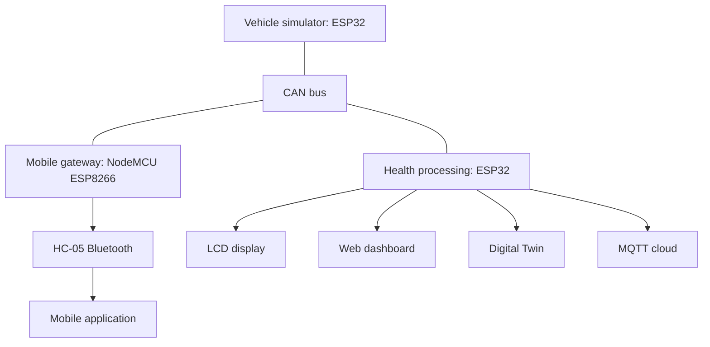

# 🚗 VehicleGuard Pro

**Smart Telematics & Diagnostic Assistant with AI-Powered Health Analytics**

---

## 📖 Overview

**VehicleGuard Pro** is an IoT-based vehicle monitoring and diagnostic system that combines **CAN bus communication**, **rule-based health analytics**, **Digital Twin technology**, **cloud connectivity**, and **real-time analytics** to monitor vehicle health.

The project simulates and monitors **50+ vehicle parameters**, estimates component health using rule-based algorithms, detects abnormal conditions, and displays information through a web dashboard, LCD, mobile application, and Digital Twin interface.

## 📸 Project Image

## ✨ Features

- 🚘 Real-time vehicle telemetry
- 🤖 Rule-based vehicle health analysis
- 🔍 Predictive maintenance support
- 📡 CAN bus communication at 250 kbps
- 🌐 Live web dashboard
- 📱 Mobile application
- 🖥 Digital Twin visualization
- 📟 LCD interface
- ☁ MQTT cloud connectivity
- 📍 GPS tracking
- 📊 Health analytics
- ⚠ Fault detection
- 🔔 Real-time alerts and notifications

## System Architecture

## Project Highlights

- **50+** vehicle parameters
- **22** CAN message IDs
- Rule-based health analytics
- Digital Twin visualization
- GPS integration
- Bluetooth mobile application
- MQTT cloud monitoring
- Web dashboard and LCD interface
- Real-time alerts

## Hardware Used

| Component | Quantity |
| --- | ---: |
| ESP32 development board | 2 |
| NodeMCU ESP8266 | 1 |
| MCP2515 CAN module | 1 |
| TJA1050 CAN transceiver | 2 |
| HC-05 Bluetooth module | 1 |
| MPU6050 sensor | 1 |
| NEO-6M GPS module | 1 |
| 16 × 2 I²C LCD | 1 |
| Rotary encoder | 1 |
| Push buttons | 4 |
| Potentiometers | 3 |
| LEDs | 5 |
| Buzzer | 1 |

## Software and Technologies

- Arduino IDE
- ESP32 and ESP8266 frameworks
- HTML, CSS, and JavaScript
- MQTT
- CAN protocol
- JSON
- Digital Twin visualization
- Rule-based health analytics

## Communication Technologies

| Technology | Interface or protocol |
| --- | --- |
| CAN | CAN 2.0B |
| Serial and peripheral interfaces | UART, SPI, I²C |
| Wireless connectivity | Bluetooth, Wi-Fi |
| Messaging | MQTT |

## Health Monitoring

VehicleGuard Pro analyzes vehicle parameters to estimate the health of:

- Engine
- Battery
- Brakes
- Engine oil
- Overall vehicle system

The rule-based analytics engine evaluates incoming values and generates alerts for abnormal conditions.

## Parameters Monitored

### Engine

- RPM
- Engine load
- Horsepower
- Torque
- Engine hours

### Temperature

- Coolant temperature
- Oil temperature
- Exhaust temperature
- Catalytic converter temperature

### Electrical

- Battery voltage
- Alternator voltage
- Battery health
- State of charge

### Brake System

- Brake pad wear
- Brake fluid
- Brake pressure
- Brake temperature

### Tyres

- Pressure
- Temperature
- Wear

### Fuel

- Fuel level
- Fuel consumption
- Fuel pressure

### GPS

- Latitude
- Longitude
- Altitude
- Speed
- Satellite count

## Multi-Platform Visualization

- Responsive web dashboard
- Digital Twin interface
- Bluetooth mobile application
- LCD dashboard
- MQTT cloud dashboard

## Project Workflow

1. Vehicle inputs are acquired or generated by the ESP32 vehicle simulator.
2. Telemetry is transmitted over the CAN bus.
3. The processing ESP32 evaluates the data and calculates health indicators.
4. Results are displayed through the LCD, web dashboard, and Digital Twin, and published through MQTT.
5. The mobile gateway forwards telemetry through the HC-05 Bluetooth module to the mobile application.

## Applications

- Smart vehicle prototypes
- Connected-car demonstrations
- Fleet-management research
- Automotive research
- Educational projects
- Vehicle health monitoring
- Industrial telematics
- Automotive IoT

## Reported Performance

The following figures are supplied project specifications and reported performance values.

| Metric | Reported value |
| --- | ---: |
| Vehicle parameters | 50+ |
| CAN message IDs | 22 |
| CAN packet loss | <0.1% |
| Web response time | <500 ms |
| Health prediction accuracy | >95% |

## 🎥 Demonstration Video

[▶ Watch the VehicleGuard Pro demonstration on YouTube](https://youtu.be/OBOi5btmlYw)

## Author

**Eshwar Prasad Y**  
Electronics & Communication Engineering

Embedded Systems | IoT | AI | Automotive Electronics | Digital Twin

- **Email:** [eshwargowda313@gmail.com](mailto:eshwargowda313@gmail.com)
- **LinkedIn:** [Eshwar Prasad Y](https://www.linkedin.com/in/eshwar-prasad-y-a3043b370/)

## Acknowledgements

Special thanks to:

- Arduino Community
- ESP32 Community
- EMQX MQTT
- Open Source Community

---

**VehicleGuard Pro · ESP32 · CAN Bus · Vehicle Health Analytics · Digital Twin**
